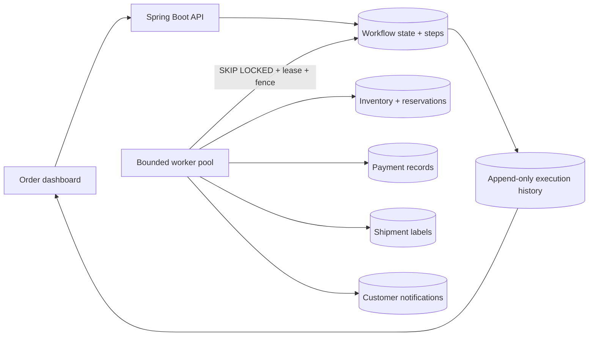

# Relay — Durable Order Fulfillment Engine

Relay is a small workflow orchestration platform built around a concrete commerce operation: taking an order from inventory reservation through payment, shipment creation and customer notification. The project shows how a backend can coordinate multiple steps, retain progress across worker failures, retry safely and compensate inventory when payment cannot complete.

## Run the demo

Requirements: Docker Desktop, Docker Compose and Java 21 (Java is only needed for local Maven development).

```bash
docker compose up --build
```

Open **http://localhost:8082/**. Place an order and choose **Timeout once, then recover** to see a payment attempt fail, wait with exponential backoff, retry, and complete. Choose **Decline every attempt** to see retry exhaustion and inventory compensation. PostgreSQL data persists in the `relay-data` volume.

- Operations dashboard: http://localhost:8082/
- API documentation: http://localhost:8082/swagger-ui.html
- Workflow API: http://localhost:8082/api/v1/workflows
- Order API: http://localhost:8082/api/v1/orders
- Product availability: http://localhost:8082/api/v1/catalog
- PostgreSQL: `localhost:5434` (database/user/password: `relay`)

Only ports 8082 and 5434 are published. Ports 80 and 81 are unused.

## What happens to an order

1. **Reserve inventory**: atomically decrement available stock and write a reservation in one transaction.
2. **Capture payment**: persist a payment record. The demo gateway can approve, fail once or decline every attempt.
3. **Create shipment**: persist a shipment label with a stable tracking reference.
4. **Notify customer**: persist a confirmation notification.

Each activity effect is keyed by workflow ID and safe to repeat. If payment exhausts its retries, Relay releases the active reservation. Every attempt and transition is recorded in workflow history.



## Submit an order with the API

```bash
curl -i http://localhost:8082/api/v1/orders \
  -H 'Content-Type: application/json' \
  -d '{
    "orderId":"ORD-10042",
    "customerName":"Alex Morgan",
    "email":"alex@example.com",
    "sku":"HEADPHONES",
    "quantity":1,
    "amount":129.00,
    "paymentScenario":"FAIL_ONCE"
  }'
```

`orderId` is the idempotency key. Repeat submission returns the original run rather than creating a second workflow. Supported SKUs and available stock are listed at `GET /api/v1/catalog`.

Payment scenarios:

- `APPROVE`: capture payment on the first attempt.
- `FAIL_ONCE`: simulate a gateway timeout, then succeed on retry.
- `DECLINE`: exhaust retries, fail the workflow and release reserved inventory.

## Inspect and operate

- `GET /api/v1/orders` list order details and fulfillment effects.
- `GET /api/v1/workflows` list all workflow runs.
- `GET /api/v1/workflows/{id}` inspect durable state.
- `GET /api/v1/workflows/{id}/steps` inspect the workflow definition.
- `GET /api/v1/workflows/{id}/history` inspect ordered execution events.
- `POST /api/v1/workflows/{id}/cancel` request cancellation.
- `POST /api/v1/workflows/{id}/retry` restart a failed or cancelled workflow from step one; idempotent effects make replay safe.

OpenAPI JSON is at `/v3/api-docs`. The dashboard supports creating orders directly and shows inventory, payment and tracking effects alongside workflow status.

## Reliability design

PostgreSQL is the source of truth. Workers claim eligible workflows with `FOR UPDATE SKIP LOCKED`, set a lease, and increment a monotonic fencing token in one atomic statement. Completion checks both owner and token, rejecting stale workers after lease reassignment. Worker concurrency is bounded by `RELAY_WORKERS` (default 4). Retry delay uses exponential backoff from `RELAY_RETRY_BASE_SECONDS` and caps at one hour. Expired leases are eligible for recovery.

Activity invocation is at least once. The included database activities are idempotent so a repeated invocation does not double reserve stock, capture payment, create a shipment or send a duplicate confirmation record. External integrations would need their own idempotency keys, transactional outbox or fencing support. The notification in this demo is persisted; it does not send real email. The payment gateway and shipment provider are local simulations backed by PostgreSQL records.

## Development

```bash
# Start PostgreSQL only
docker compose up -d postgres

# In another terminal
mvn test
mvn verify  # runs Testcontainers integration tests; requires working Docker API access
```

Configuration: `SERVER_PORT` (8082), `SPRING_DATASOURCE_URL`, `SPRING_DATASOURCE_USERNAME`, `SPRING_DATASOURCE_PASSWORD`, `RELAY_WORKERS` (4), `RELAY_POLL_MS` (500), `RELAY_LEASE_SECONDS` (30), `RELAY_RETRY_BASE_SECONDS` (2).

## Tests

Unit tests cover failure simulation and activity dispatch. PostgreSQL Testcontainers integration tests cover idempotency, ordered history, retry-safe payment/inventory effects and compensation. GitHub Actions runs `mvn verify` on Java 21.

## Project map

- `src/main/java/dev/relay/domain`: API requests, workflow state and order orchestration
- `src/main/java/dev/relay/engine`: bounded worker pool, activities and compensation
- `src/main/java/dev/relay/repo`: PostgreSQL workflow claiming and state transitions
- `src/main/resources/db/migration`: Flyway schema
- `src/main/resources/templates`: dashboard and workflow detail
- `docs`: architecture, state machine, failure scenarios and engineering checklist

## Portfolio summary

**Relay — Durable Order Fulfillment Engine** · Java 21, Spring Boot, PostgreSQL, Docker, Thymeleaf

Built a persistent workflow engine that coordinates order fulfillment across inventory, payment, shipment and customer notification steps. Implemented atomic PostgreSQL work claiming with `SKIP LOCKED`, expiring leases, fencing tokens, bounded concurrent workers, idempotent activity effects, exponential retry and inventory compensation on payment failure. Added an operations dashboard, OpenAPI endpoints, Flyway migrations, Testcontainers coverage and Docker Compose deployment.

This is a portfolio reference implementation, not a production payment or shipping service. It has no authentication, tenant isolation, real external providers, operational metrics or load/chaos qualification.
