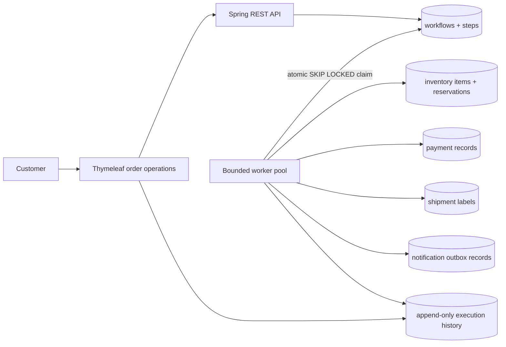

# High-Level Design

Relay demonstrates durable orchestration through a concrete order fulfillment flow.

The API accepts an order with an idempotency key and creates a durable workflow and ordered activity definitions. PostgreSQL stores workflow state, lease owner/expiry and the fencing counter. Worker threads claim work through a single `FOR UPDATE SKIP LOCKED` statement. Domain activities write business effects in PostgreSQL transactions. Their primary keys are workflow IDs, which make redelivery safe. On terminal payment failure, a compensation releases reserved inventory. Flyway evolves the schema; Thymeleaf presents an operations view over live workflow and business state.

Durability applies to engine state and the included PostgreSQL effects. Payment and carrier behavior are simulations; customer notification is recorded rather than sent to an email provider.
